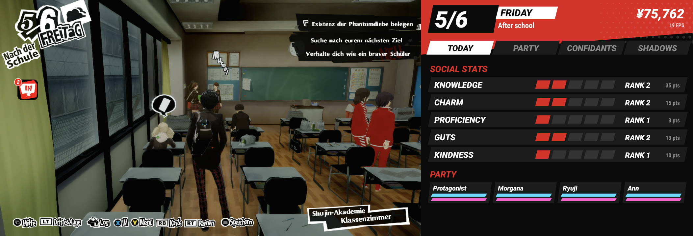
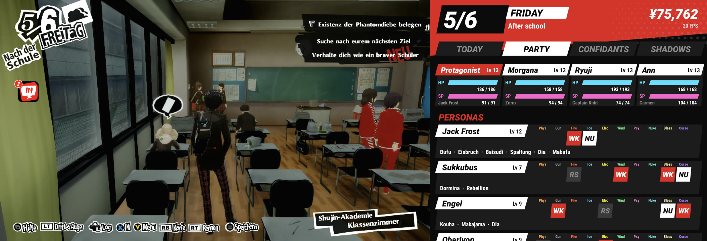
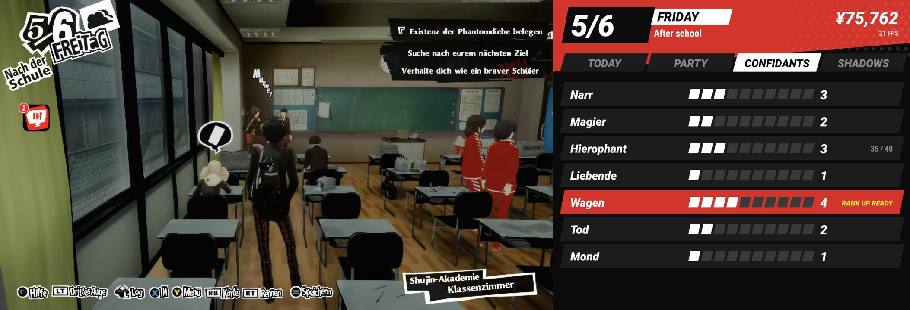
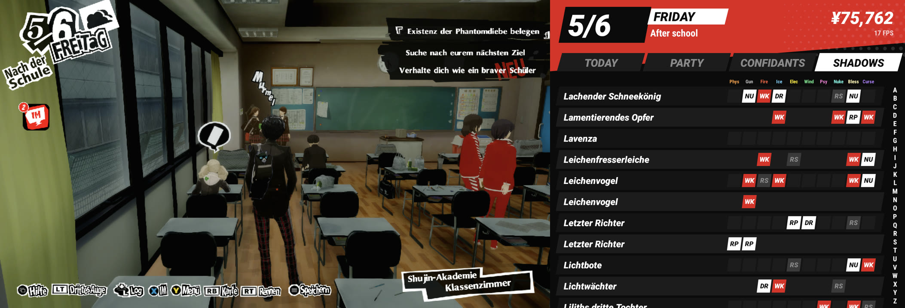

# Thor P5R

**A second-screen deck for Persona 5 Royal on the dual-screen AYN Thor.** The game runs on the top screen (your own
Steam copy through [DroidDeck](https://github.com/Droid-Deck/DroidDeck)); the bottom screen shows live data from the
game in a red-black-white look: your day, social stats, party, personas with their weaknesses, confidants that are
ready to rank up, and a lookup list of every shadow's affinities.

> **Not affiliated with ATLUS or SEGA.** Persona 5 Royal is © ATLUS / © SEGA. This is an unofficial fan project. It
> contains **no game files and no game artwork**: the look is drawn by the app itself, and every name on the deck
> (personas, skills, shadows, arcana) is read from *your own* running game, in the game's language.

> **Status: experimental.** The deck works, but the game itself is heavy for the Thor under DroidDeck – read
> [Performance](#performance-on-the-thor-read-this-first) first.

| Today: social stats and party | Party: personas with weaknesses and skills |
|---|---|
|  |  |

| Confidants: who is ready to rank up | Shadows: affinities of every shadow, A–Z |
|---|---|
|  |  |

<sub>Real screenshots from an AYN Thor (Persona 5 Royal via DroidDeck on top, Thor P5R 0.1.1 below; German game, English deck).</sub>

## What the deck does

| Tab | Content |
|---|---|
| **Header** (always) | Date, weekday, time of day, money, the game's frame rate |
| **Today** | The five social stats with rank and points; the party's HP/SP at a glance; in palaces and Mementos the security level |
| **Party** | HP, SP, level and persona of each member; every persona the protagonist carries with its **affinities** (weak, resist, null, repel, drain for the ten elements) and its skills |
| **Confidants** | Every confidant you have met, by arcana, with rank and points – and a highlight when the points for the **next rank are reached** |
| **Shadows** | A lookup list of all shadows with their affinities, alphabetical with an A–Z index: tap the letter, read the weakness |

The deck only reads. It never takes the controller: after a touch the focus goes back to the game screen. DroidDeck
opens its own control panel on the bottom screen; the deck puts itself in front of it. Hold the deck's header for a
second to get DroidDeck's panel; closing that panel brings the deck back.

Languages: English and German labels (follows the device language); all names come from the game.

## Performance on the Thor (read this first)

Measured on an AYN Thor (Snapdragon 8 Gen 2, 12 GB) with DroidDeck 0.7.1, game graphics set to *Low*, 30 fps limit:

- **About 15–25 fps** in 3D areas (a classroom, a palace safe room), about 40 fps in menus and the intro. The game runs
  as an x86 program under emulation; the deck itself costs 1–2 fps.
- **Memory is at the limit.** While the game loads, Android may end other apps, including the deck; the deck comes
  back by itself (see Install, step 3). With extra load on the device – installing an app, recording both screens –
  Android ended the **game** several times in my tests, and sometimes once while it was starting (DroidDeck then
  starts it again). Restarting the device first and running nothing else helps.
- A long play session was not tested.

If that is not good enough for you, this project cannot fix it: it is a property of the game under DroidDeck on this
hardware.

## How it works

```
Persona 5 Royal (Steam, Proton in DroidDeck)          Android
┌────────────────────────────────────┐  127.0.0.1:8767  ┌──────────────────┐
│ P5R.exe + status mod               │ ◄──────────────► │ Thor P5R deck    │
│ (steam_api64.dll forwards to the   │   JSON           │ (bottom screen)  │
│  game's own, kept as …_o.dll)      │                  └──────────────────┘
└────────────────────────────────────┘
```

- `mod/` is a small Windows DLL in C. It takes the name of the game's `steam_api64.dll`, forwards every call to the
  original (kept as `steam_api64_o.dll`) and starts a tiny HTTP server bound to 127.0.0.1. Twice a second, on the
  game's main thread, it asks the game's **own script functions** (the getters the game's scripts use: date, party,
  HP, confidant rank …) and reads a few tables from memory. It changes nothing in the game.
- `app/` is the Android app `de.harmssi.thorp5r`: a starter that launches the game in DroidDeck on the top screen and
  the deck on the bottom screen.
- Works with the Steam build of 23 Aug 2024 (1.04, the current one). The script functions are found by name, so they
  should survive a game update; the affinity tables are tied to this build and are switched off on any other.

## Install

You need: an AYN Thor (or another dual-screen Android handheld), your own **Persona 5 Royal on Steam** installed in
DroidDeck **on the SD card** (the internal Steam library cannot be reached with adb), a computer with `adb`.

1. **Status mod** (once, and again after a game update or "verify files"):
   ```sh
   mod/install_device.sh "<game folder on the device>" steam_api64.dll     # the DLL from the release
   ```
   The game folder is usually
   `/storage/<sd card>/Android/data/com.droiddeck.launcher/files/steam/steamapps/common/P5R`.
   The game's own DLL is kept as `steam_api64_o.dll`; `mod/uninstall_device.sh` puts it back.
2. **The deck:** `adb install ThorP5R-0.1.1.apk` (from the release).
3. **Let the deck come back by itself:** allow *Display over other apps* for Thor P5R (Android settings → Apps →
   Special app access), or `adb shell appops set de.harmssi.thorp5r SYSTEM_ALERT_WINDOW allow`. Android may end the
   deck while the game loads; with this permission it reopens within about half a minute. Nothing is drawn over
   other apps.
4. In the game, set the graphics to *Low* (Config → Graphics). Then start **Thor P5R**.

## Build

```sh
(cd app && ./build.sh)                              # -> app/dist/ThorP5R.apk   (Android SDK path in app/local.properties)
mod/make_proxy.sh <your game's steam_api64.dll>     # -> mod/out/steam_api64.dll   (needs x86_64-w64-mingw32-gcc)
```

`P5_EXTRA=-DP5_DEBUG mod/make_proxy.sh …` adds debug routes (a memory viewer and direct script calls) that were used
to find the addresses. They can crash the game and are not in release builds.

## Not in this version

- No automatic "this is the enemy in front of you": the deck does not follow battles yet. Use the Shadows list.
- No weather forecast, no Mementos requests, no item list.
- The Shadows list shows the game's data for every shadow, whether you have analysed it or not.

## Licence and thanks

- GPL-3.0-or-later, see `LICENSE`.
- The way to call the game's script functions (signatures, context layout) was learned from
  [p5rpc.lib](https://github.com/AnimatedSwine37/p5rpc.lib) by AnimatedSwine37 (GPL-3.0); unit layout and name-table
  signatures from [p5rpc.tools.modeditor](https://github.com/SpyPidgeon/p5rpc.tools.modeditor) by SpyPidgeon
  (Unlicense). The code here is written from scratch in C. Thank you both.
- DroidDeck for running Steam games on Android.

⭐ If it works for you, a star on GitHub helps the project.
🔔 Subscribe for the next port: https://www.youtube.com/@toravomusic?sub_confirmation=1
